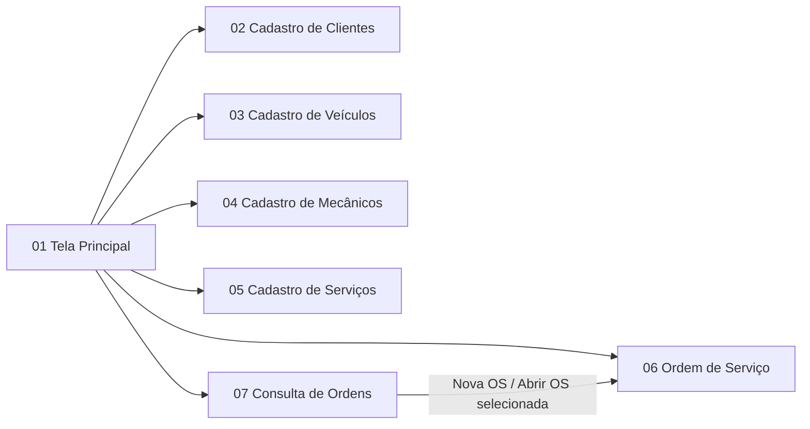
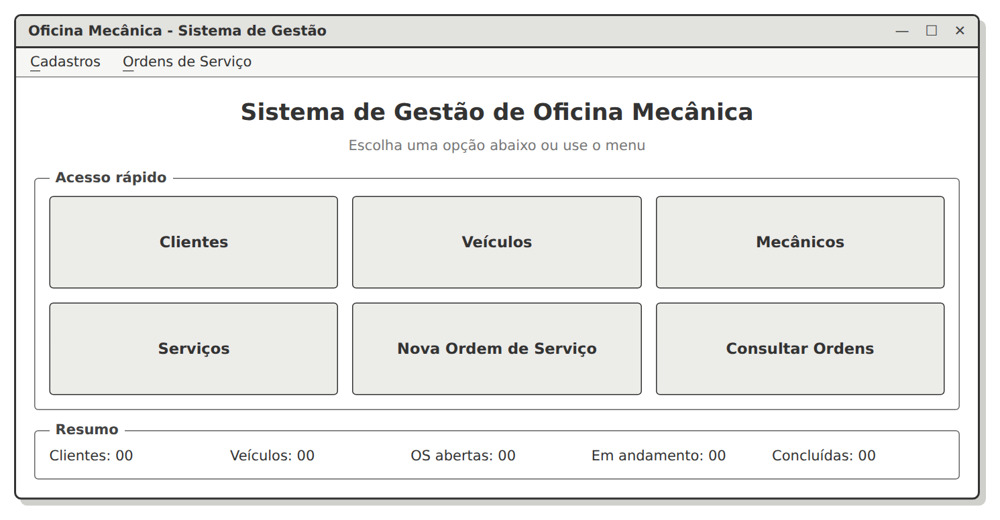
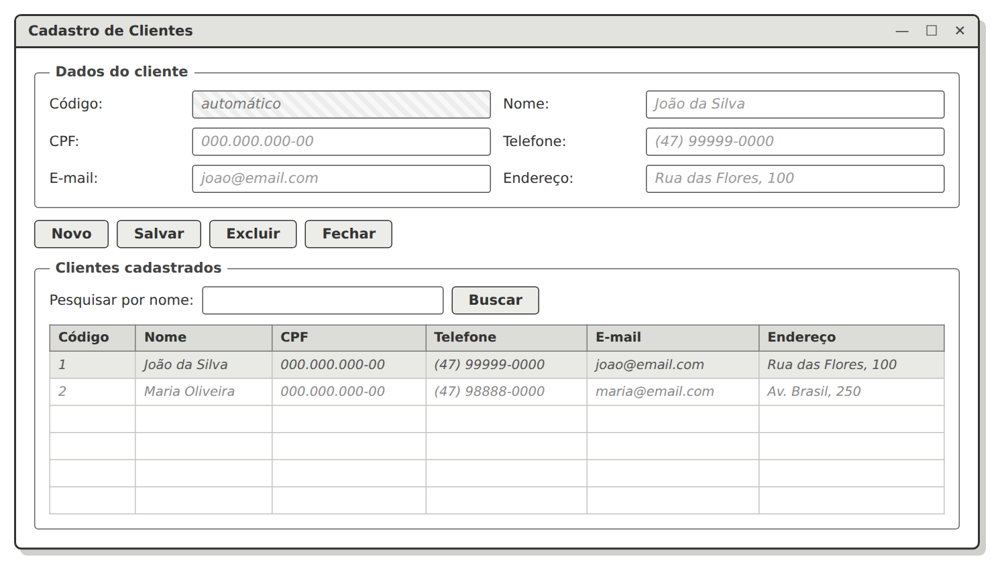
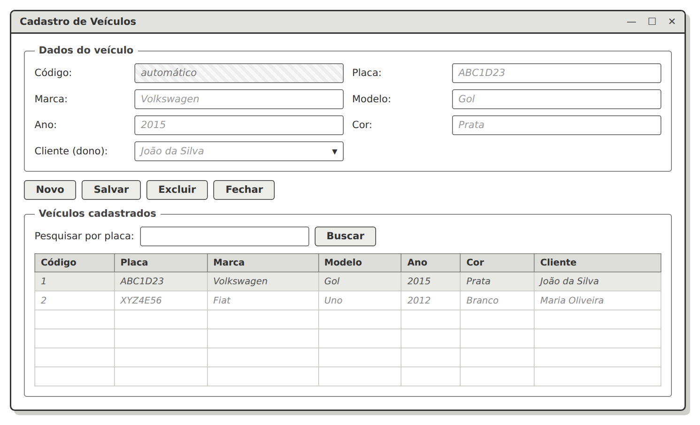
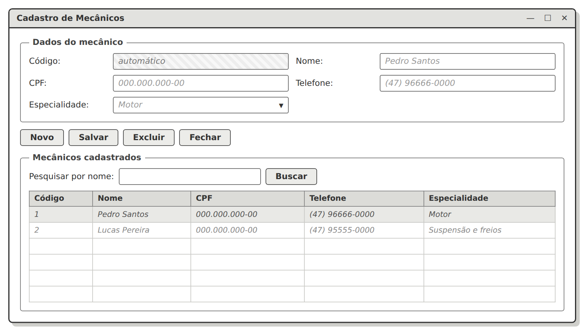
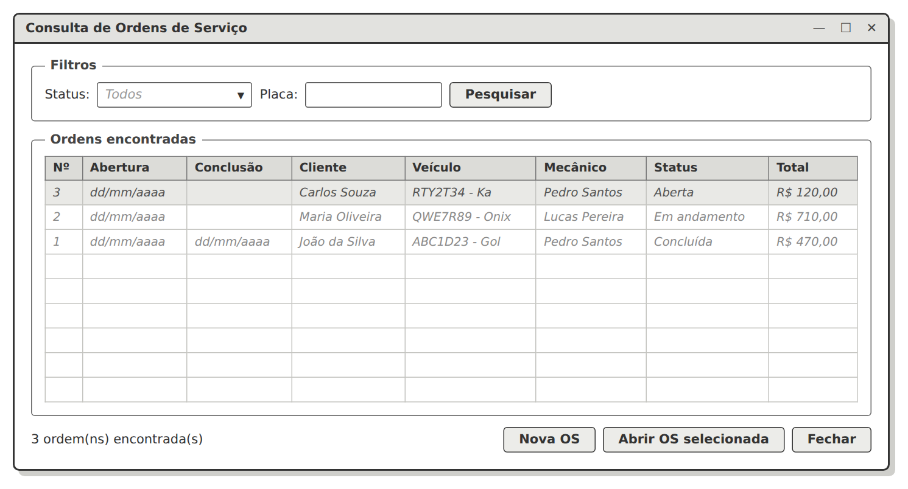
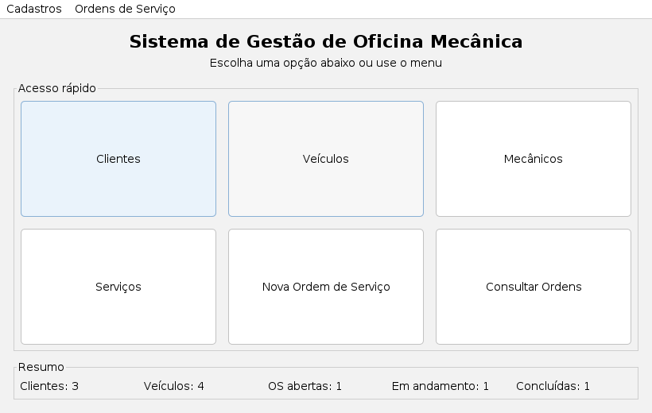
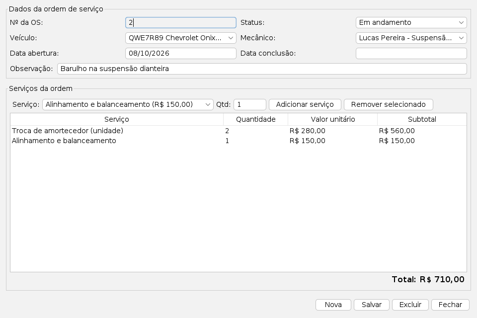
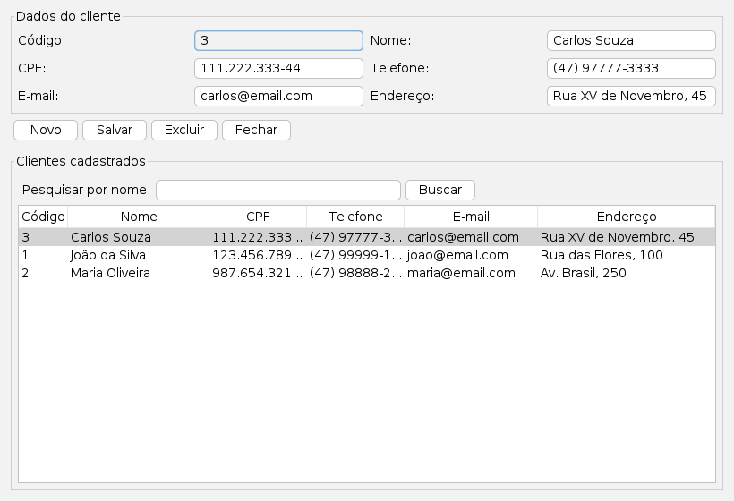
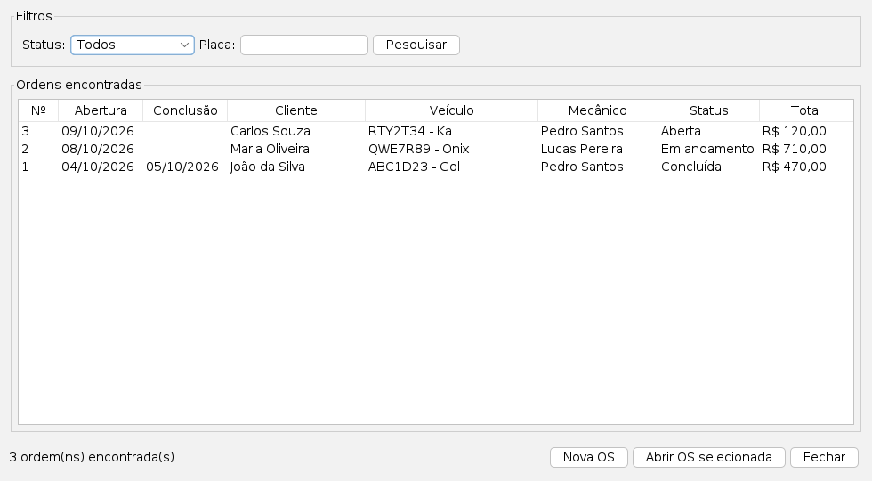

# Sistema de Gestão de Oficina Mecânica

Sistema desktop desenvolvido em **Java Swing** para a disciplina de Programação Orientada a Objetos II, com banco de dados **MySQL** (via JDBC) e padrão de projeto **MVC**.

**Sumário:**
1. [Tema do sistema](#1-tema-do-sistema)
2. [Requisitos da atividade](#2-requisitos-da-atividade)
3. [Protótipos de tela](#3-protótipos-de-tela)
4. [Diagrama de classes](#4-diagrama-de-classes)
5. [Diagrama MER](#5-diagrama-mer)
6. [Sistema em execução](#6-sistema-em-execução)
7. [Estrutura MVC do projeto](#7-estrutura-mvc-do-projeto)

---

## 1. Tema do sistema

O **Sistema de Gestão de Oficina Mecânica** é destinado a oficinas de pequeno porte, que muitas vezes controlam os atendimentos em cadernos ou planilhas.

O sistema permite cadastrar:
- os **clientes**;
- os **veículos** desses clientes;
- os **mecânicos** da oficina;
- os **serviços** oferecidos, com seus preços.

Além disso, registra as **Ordens de Serviço (OS)**. Cada OS indica qual veículo foi atendido, qual mecânico é o responsável, quais serviços foram realizados e o valor total.

### Funcionalidades

| # | Funcionalidade | Descrição |
|---|---|---|
| F01 | Manter Clientes | Cadastrar, alterar, excluir e pesquisar clientes |
| F02 | Manter Veículos | Cadastrar, alterar, excluir e pesquisar veículos, vinculando cada um ao seu dono |
| F03 | Manter Mecânicos | Cadastrar, alterar, excluir e pesquisar mecânicos |
| F04 | Manter Serviços | Cadastrar, alterar, excluir e pesquisar serviços e seus preços |
| F05 | Registrar Ordem de Serviço | Abrir uma OS com veículo, mecânico e serviços, com o total calculado |
| F06 | Atualizar Ordem de Serviço | Alterar o status, as datas e os serviços de uma OS |
| F07 | Consultar Ordens | Listar as ordens com filtro por status e por placa |
| F08 | Painel principal | Mostrar os totais de clientes, veículos e ordens por status |

### Regras de negócio
- O CPF de clientes e mecânicos e a placa dos veículos não podem se repetir.
- Todo veículo pertence a um cliente.
- Toda OS precisa de um veículo, um mecânico e **pelo menos um serviço**.
- Ao concluir uma OS sem data de conclusão, o sistema usa a data de hoje.
- A data de conclusão não pode ser anterior à data de abertura.
- Não é possível excluir:
  - um cliente que tenha veículos;
  - um veículo ou um mecânico que tenha ordens de serviço;
  - um serviço já usado em alguma ordem de serviço.
- A OS e os seus itens são gravados em uma **transação** (commit/rollback): ou tudo é salvo, ou nada é salvo.

---

## 2. Requisitos da atividade

| Requisito | Como foi atendido |
|---|---|
| Java Swing | Telas com `JFrame`, `JPanel`, `JTable`, `JComboBox`, `JMenuBar` e os layouts `BorderLayout`, `GridLayout` e `FlowLayout` |
| Integração com banco de dados | MySQL acessado por JDBC (`ConnectionFactory`, `BaseDAO` e um DAO por tabela) |
| 4 ou mais tabelas | 6 tabelas: `cliente`, `veiculo`, `mecanico`, `servico`, `ordem_servico` e `item_servico` |
| Várias telas | 7 telas, descritas abaixo |
| Padrão MVC | Pacotes `model` (entity, dao, usecase, exception, database), `control` e `view` |

---

## 3. Protótipos de tela

Wireframes feitos na 1ª etapa do trabalho:

| # | Tela | Protótipo |
|---|---|---|
| 01 | Tela Principal | [01-tela-principal.png](docs/prototipos/01-tela-principal.png) |
| 02 | Cadastro de Clientes | [02-cadastro-clientes.png](docs/prototipos/02-cadastro-clientes.png) |
| 03 | Cadastro de Veículos | [03-cadastro-veiculos.png](docs/prototipos/03-cadastro-veiculos.png) |
| 04 | Cadastro de Mecânicos | [04-cadastro-mecanicos.png](docs/prototipos/04-cadastro-mecanicos.png) |
| 05 | Cadastro de Serviços | [05-cadastro-servicos.png](docs/prototipos/05-cadastro-servicos.png) |
| 06 | Ordem de Serviço | [06-ordem-de-servico.png](docs/prototipos/06-ordem-de-servico.png) |
| 07 | Consulta de Ordens de Serviço | [07-consulta-ordens.png](docs/prototipos/07-consulta-ordens.png) |

### Navegação entre as telas



### 01 — Tela Principal


### 02 — Cadastro de Clientes


### 03 — Cadastro de Veículos


### 04 — Cadastro de Mecânicos


### 05 — Cadastro de Serviços


### 06 — Ordem de Serviço


### 07 — Consulta de Ordens de Serviço


---

## 4. Diagrama de classes


| Relacionamento | Multiplicidade | Explicação |
|---|---|---|
| Cliente — Veiculo | 1 para 0..* | Um cliente pode ter vários veículos. Cada veículo pertence a um único cliente. |
| Veiculo — OrdemServico | 1 para 0..* | Um veículo pode ter várias ordens ao longo do tempo. Cada ordem é de um único veículo. |
| Mecanico — OrdemServico | 1 para 0..* | Um mecânico pode ser responsável por várias ordens. Cada ordem tem um único mecânico. |
| OrdemServico ◆— ItemServico | 1 para 1..* | **Composição**: os itens fazem parte da ordem e não existem sem ela. |
| Servico — ItemServico | 1 para 0..* | Um serviço pode aparecer em vários itens. Cada item se refere a um único serviço. |
| OrdemServico ⇢ StatusOrdem | dependência | A ordem usa o enum para indicar sua situação. |

> O cliente não fica ligado diretamente à Ordem de Serviço: ele é obtido pelo veículo (`OS → Veículo → Cliente`).

---

## 5. Diagrama MER


> No diagrama, `DECIMAL(10-2)` representa `DECIMAL(10,2)`.

| Tabela | Chave primária | Chaves estrangeiras | Valor único |
|---|---|---|---|
| cliente | id | — | cpf |
| veiculo | id | cliente_id → cliente(id) | placa |
| mecanico | id | — | cpf |
| servico | id | — | — |
| ordem_servico | id | veiculo_id → veiculo(id); mecanico_id → mecanico(id) | — |
| item_servico | id | ordem_servico_id → ordem_servico(id); servico_id → servico(id) | — |

A tabela **item_servico** resolve o relacionamento **N:N** entre `ordem_servico` e `servico`. Ela também guarda a quantidade e o valor do serviço no dia em que a OS foi feita.

O script completo do banco está em [docs/banco.sql](docs/banco.sql).

---

## 6. Sistema em execução

| Tela Principal | Ordem de Serviço |
|---|---|
|  |  |

| Cadastro de Clientes | Consulta de Ordens |
|---|---|
|  |  |

Todas as telas: [docs/telas](docs/telas)

---

## 7. Estrutura MVC do projeto

```
src/main/java/br/edu/univille/poo/
├── App.java                      → inicia o sistema
├── model/                        → MODEL: dados e regras de negócio
│   ├── entity/                   → Cliente, Veiculo, Mecanico, Servico, OrdemServico, ItemServico, StatusOrdem, Resumo
│   ├── dao/                      → ConnectionFactory, BaseDAO e um DAO por tabela (SQL via JDBC)
│   ├── usecase/                  → casos de uso (Salvar, Excluir, Pesquisar...), com as regras de negócio
│   ├── exception/                → exceções do sistema (ex.: ClienteComVeiculosException)
│   └── database/                 → DatabaseCreator (cria banco e tabelas) e DatabaseInitialize (dados de exemplo)
├── control/                      → CONTROLLER: recebe as ações das telas e chama os casos de uso
│   ├── principal/  cliente/  veiculo/  mecanico/  servico/  ordemservico/
├── view/                         → VIEW: telas em Java Swing
│   ├── principal/  cliente/  veiculo/  mecanico/  servico/  ordemservico/
│   └── componente/ViewUtil.java  → métodos auxiliares das telas
└── util/StringsUtil.java
```

**Fluxo de uma ação** (exemplo: salvar um cliente):

```
ClienteView (botão Salvar)
   → ClienteController.salvar(cliente)
      → SalvarClienteUseCase.executar(cliente)   // valida nome, CPF e duplicidade
         → ClienteDAO.inserir(cliente)           // INSERT INTO cliente ...
            → ConnectionFactory → MySQL
```
