# Sistema WEB de Gestão de Oficina Mecânica

Sistema web desenvolvido com o **Spring Framework** (Spring Boot, **Spring MVC**, **Thymeleaf** e **Spring Data JPA**) para a disciplina de Programação Orientada a Objetos II. É a evolução do sistema desktop em Java Swing, mantendo o mesmo tema, agora na arquitetura **MVC** para a web e com banco de dados relacional.

**Sumário:**
1. [Tema do sistema](#1-tema-do-sistema)
2. [Requisitos da atividade](#2-requisitos-da-atividade)
3. [Protótipos de tela](#3-protótipos-de-tela)
4. [Diagrama de classes](#4-diagrama-de-classes)
5. [Diagrama MER](#5-diagrama-mer)
6. [Arquitetura MVC do projeto](#6-arquitetura-mvc-do-projeto)
7. [Como executar](#7-como-executar)

---

## 1. Tema do sistema

O **Sistema de Gestão de Oficina Mecânica** é destinado a oficinas de pequeno porte, que muitas vezes controlam os atendimentos em cadernos ou planilhas. Pelo navegador, o atendente da oficina cadastra:

- os **clientes**;
- os **veículos** desses clientes;
- os **mecânicos** da oficina;
- os **serviços** oferecidos, com seus preços.

Além disso, registra as **Ordens de Serviço (OS)**. Cada OS indica qual veículo foi atendido, qual mecânico é o responsável, quais serviços foram realizados e o valor total.

### Funcionalidades

| # | Funcionalidade | Descrição |
|---|---|---|
| F01 | Manter Clientes | Cadastrar, editar, excluir, listar e pesquisar clientes |
| F02 | Manter Veículos | Cadastrar, editar, excluir, listar e pesquisar veículos, vinculando cada um ao seu dono |
| F03 | Manter Mecânicos | Cadastrar, editar, excluir, listar e pesquisar mecânicos |
| F04 | Manter Serviços | Cadastrar, editar, excluir, listar e pesquisar serviços e seus preços |
| F05 | Manter Ordens de Serviço | Abrir, editar, excluir e listar ordens, com veículo, mecânico e serviços, e o total calculado |
| F06 | Consultar Ordens | Filtrar as ordens por status e por placa |
| F07 | Painel principal | Mostrar os totais de clientes, veículos e ordens por status, e as últimas ordens |

### Regras de negócio

- O CPF de clientes e mecânicos e a placa dos veículos não podem se repetir.
- Todo veículo pertence a um cliente.
- Toda OS precisa de um veículo, um mecânico e **pelo menos um serviço**.
- Ao concluir uma OS sem data de conclusão, o sistema usa a data de hoje.
- A data de conclusão não pode ser anterior à data de abertura.
- O item da OS guarda o preço do serviço no dia do atendimento: mudar o preço de um serviço não altera as ordens já registradas.
- Não é possível excluir:
  - um cliente que tenha veículos;
  - um veículo ou um mecânico que tenha ordens de serviço;
  - um serviço já usado em alguma ordem de serviço.
- A OS e os seus itens são gravados na mesma **transação** (`@Transactional`): ou tudo é salvo, ou nada é salvo.

---

## 2. Requisitos da atividade

| Requisito | Como foi atendido |
|---|---|
| Integração com banco de dados relacional | Banco **H2** acessado pelo **Spring Data JPA** (Hibernate), com chaves primárias, estrangeiras e campos únicos |
| 4 ou mais tabelas | **6 tabelas**: `cliente`, `veiculo`, `mecanico`, `servico`, `ordem_servico` e `item_servico` |
| CRUDs (cadastro, edição, exclusão, listagem) | 5 CRUDs completos: clientes, veículos, mecânicos, serviços e ordens de serviço |
| Spring Framework | **Spring MVC** (`@Controller`), **Thymeleaf** (telas HTML) e **Spring Data JPA** (`JpaRepository`) |
| Arquitetura MVC | **Model**: Entity, Repository e Service · **Control**: Controllers · **View**: HTML/CSS/JS |
| Control não acessa Repository | Os Controllers recebem apenas **Services** no construtor; só os Services usam os Repositories |

---

## 3. Protótipos de tela

Os protótipos foram feitos em **HTML/CSS** e podem ser abertos no navegador. Eles são navegáveis: o menu, os botões e os links levam de uma tela para a outra.

**Link para os protótipos:** [docs/prototipos](docs/prototipos)

> Para navegar, abra o arquivo [`docs/prototipos/01-painel.html`](docs/prototipos/01-painel.html) no navegador (baixando o repositório) ou use o visualizador online:
> [abrir o protótipo navegável](https://htmlpreview.github.io/?https://github.com/maicon-junior/oficina-mecanica/blob/main/oficina%20mecanica%201/docs/prototipos/01-painel.html).

| # | Tela | Tipo | Protótipo HTML | Imagem |
|---|---|---|---|---|
| 01 | Painel principal | Início | [01-painel.html](docs/prototipos/01-painel.html) | [png](docs/prototipos/01-painel.png) |
| 02 | Ordens de serviço | Listagem e filtro | [02-ordens-lista.html](docs/prototipos/02-ordens-lista.html) | [png](docs/prototipos/02-ordens-lista.png) |
| 03 | Ordem de serviço | Cadastro / edição | [03-ordem-form.html](docs/prototipos/03-ordem-form.html) | [png](docs/prototipos/03-ordem-form.png) |
| 04 | Clientes | Listagem e pesquisa | [04-clientes-lista.html](docs/prototipos/04-clientes-lista.html) | [png](docs/prototipos/04-clientes-lista.png) |
| 05 | Cliente | Cadastro / edição | [05-cliente-form.html](docs/prototipos/05-cliente-form.html) | [png](docs/prototipos/05-cliente-form.png) |
| 06 | Veículos | Listagem e pesquisa | [06-veiculos-lista.html](docs/prototipos/06-veiculos-lista.html) | [png](docs/prototipos/06-veiculos-lista.png) |
| 07 | Veículo | Cadastro / edição | [07-veiculo-form.html](docs/prototipos/07-veiculo-form.html) | [png](docs/prototipos/07-veiculo-form.png) |
| 08 | Mecânicos | Listagem e pesquisa | [08-mecanicos-lista.html](docs/prototipos/08-mecanicos-lista.html) | [png](docs/prototipos/08-mecanicos-lista.png) |
| 09 | Mecânico | Cadastro / edição | [09-mecanico-form.html](docs/prototipos/09-mecanico-form.html) | [png](docs/prototipos/09-mecanico-form.png) |
| 10 | Serviços | Listagem e pesquisa | [10-servicos-lista.html](docs/prototipos/10-servicos-lista.html) | [png](docs/prototipos/10-servicos-lista.png) |
| 11 | Serviço | Cadastro / edição | [11-servico-form.html](docs/prototipos/11-servico-form.html) | [png](docs/prototipos/11-servico-form.png) |
| 12 | Confirmar exclusão | Exclusão (usada por todos os cadastros) | [12-confirmar-exclusao.html](docs/prototipos/12-confirmar-exclusao.html) | [png](docs/prototipos/12-confirmar-exclusao.png) |

### Navegação entre as telas

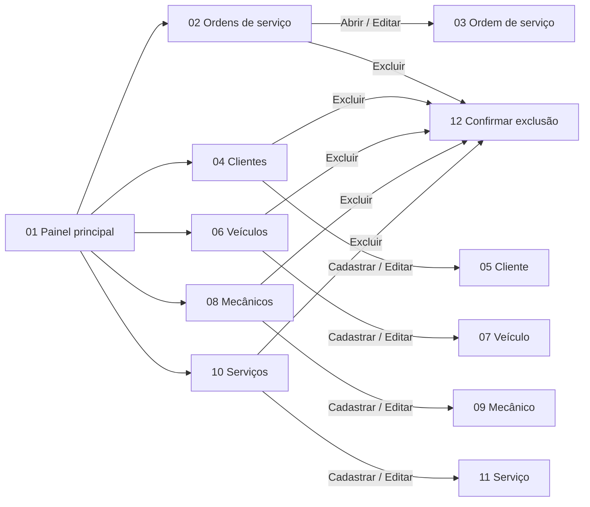

### 01 — Painel principal
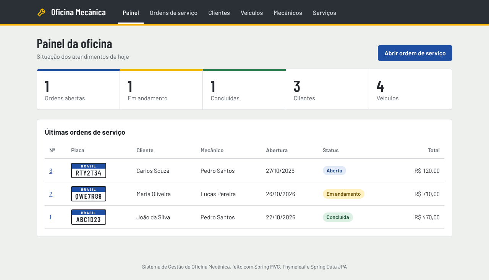

### 02 — Ordens de serviço (listagem)
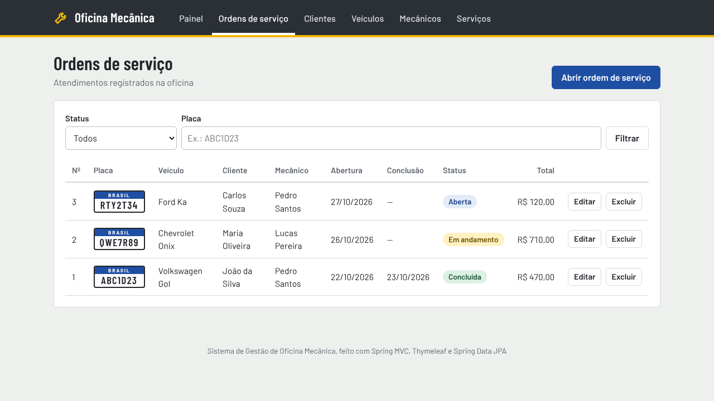

### 03 — Ordem de serviço (cadastro / edição)
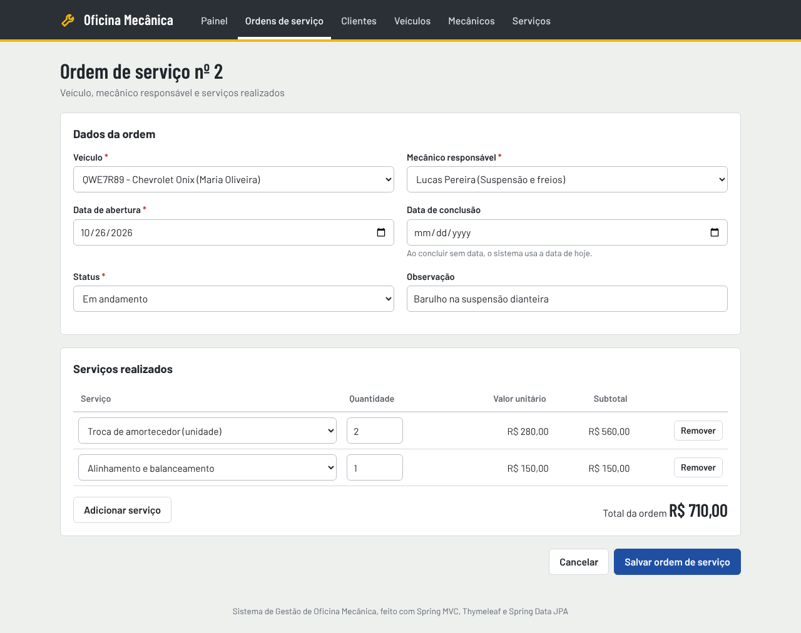

### 04 — Clientes (listagem)
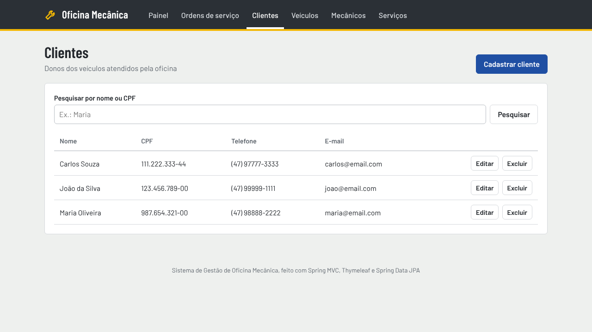

### 05 — Cliente (cadastro / edição)
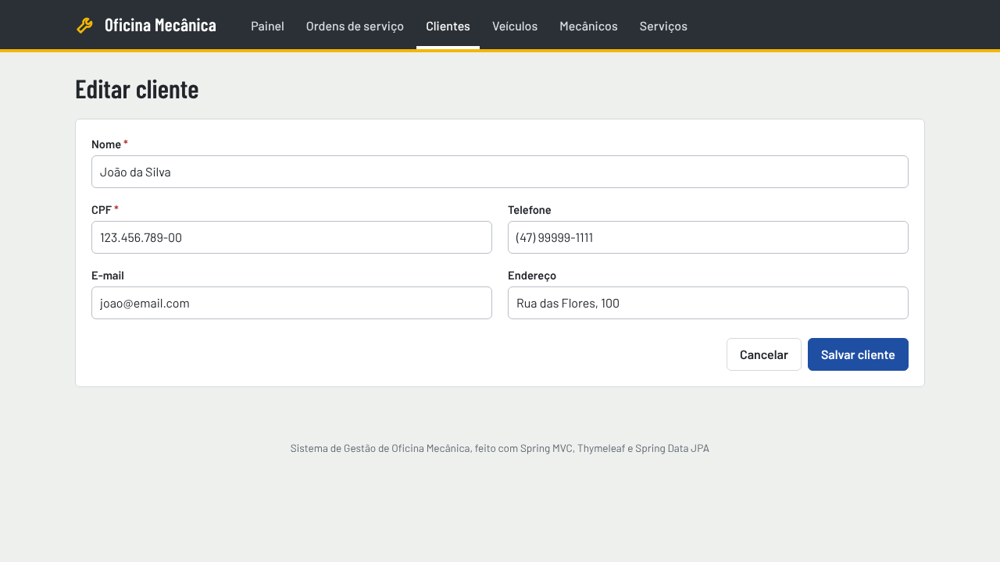

### 06 — Veículos (listagem)
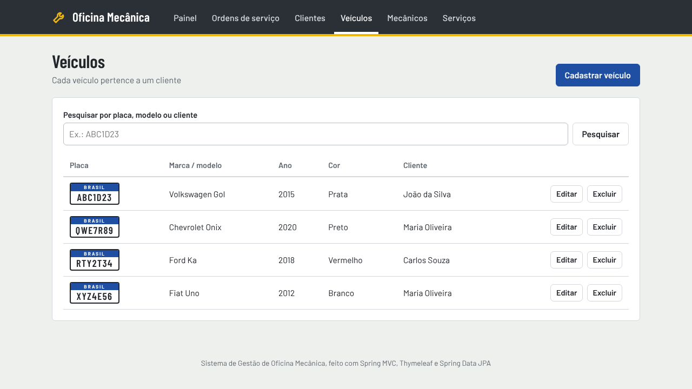

### 07 — Veículo (cadastro / edição)
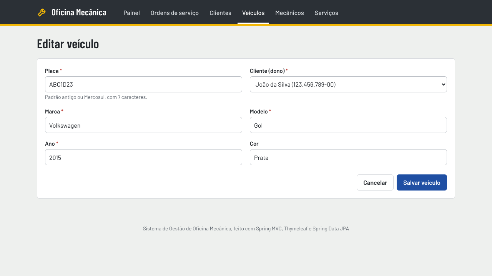

### 08 — Mecânicos (listagem)
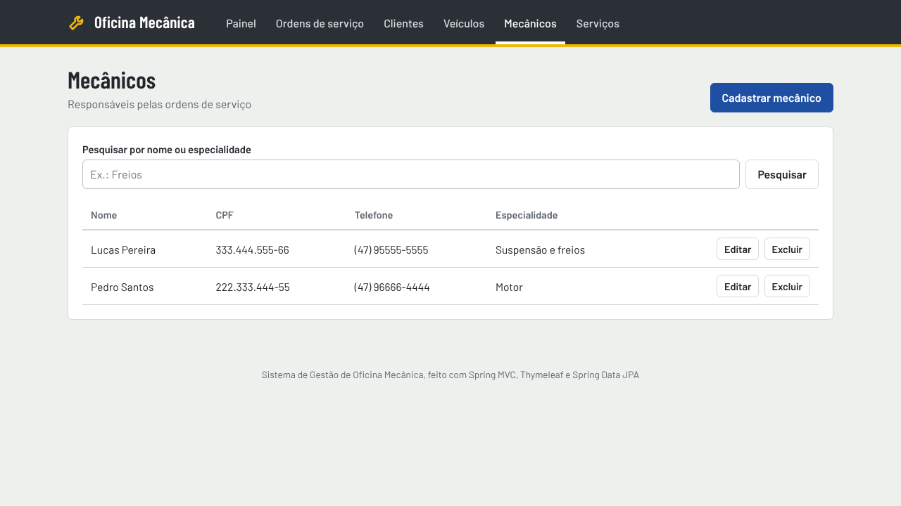

### 09 — Mecânico (cadastro / edição)
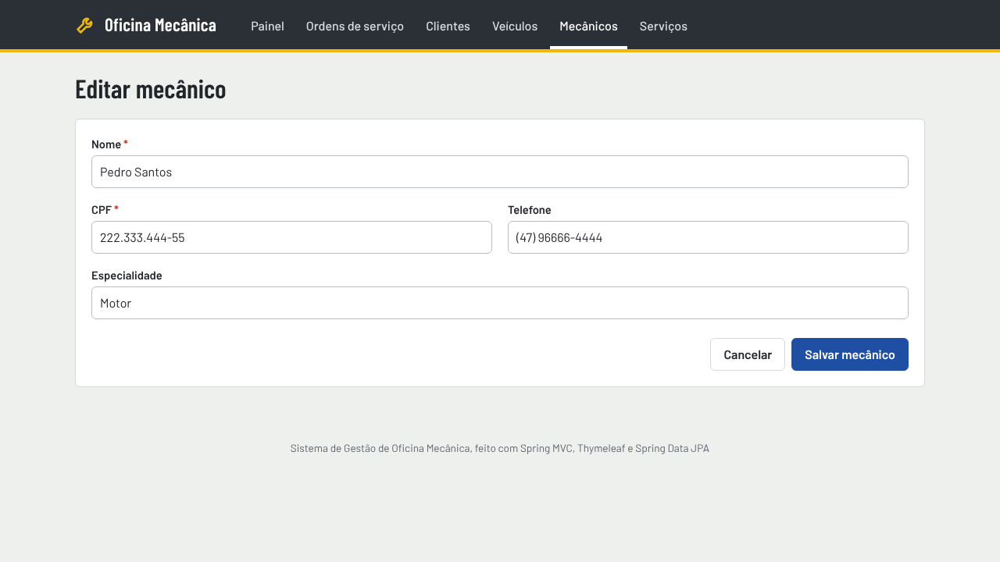

### 10 — Serviços (listagem)
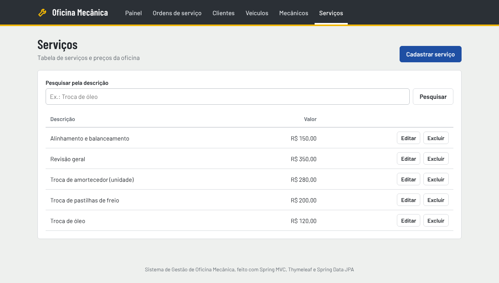

### 11 — Serviço (cadastro / edição)
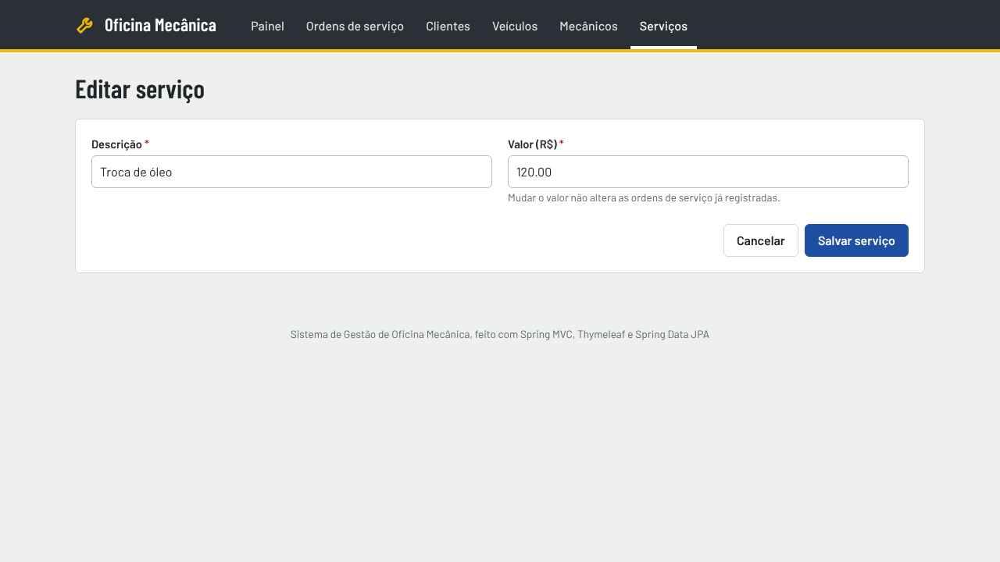

### 12 — Confirmar exclusão
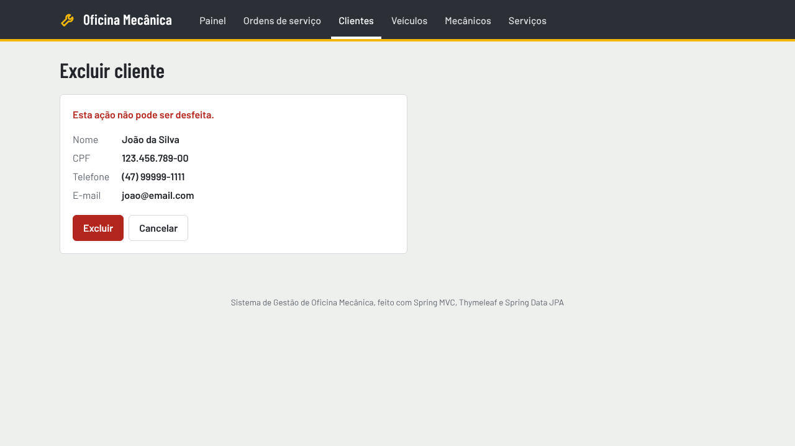

---

## 4. Diagrama de classes

### 4.1 Entidades do sistema

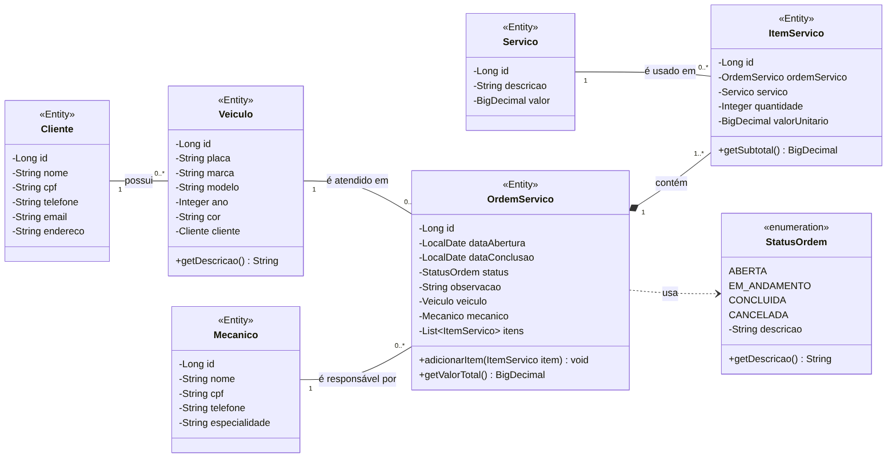

Fonte do diagrama (Mermaid): [docs/diagramas/diagrama-classes.mmd](docs/diagramas/diagrama-classes.mmd)

| Relacionamento | Multiplicidade | Explicação |
|---|---|---|
| Cliente — Veiculo | 1 para 0..* | Um cliente pode ter vários veículos. Cada veículo pertence a um único cliente (`@ManyToOne`). |
| Veiculo — OrdemServico | 1 para 0..* | Um veículo pode ter várias ordens ao longo do tempo. Cada ordem é de um único veículo. |
| Mecanico — OrdemServico | 1 para 0..* | Um mecânico pode ser responsável por várias ordens. Cada ordem tem um único mecânico. |
| OrdemServico ◆— ItemServico | 1 para 1..* | **Composição**: os itens fazem parte da ordem e não existem sem ela (`@OneToMany(cascade = ALL, orphanRemoval = true)`). |
| Servico — ItemServico | 1 para 0..* | Um serviço pode aparecer em vários itens. Cada item se refere a um único serviço. |
| OrdemServico ⇢ StatusOrdem | dependência | A ordem usa o enum para indicar sua situação (`@Enumerated(EnumType.STRING)`). |

> O cliente não fica ligado diretamente à Ordem de Serviço: ele é obtido pelo veículo (`OS → Veículo → Cliente`).

### 4.2 Camadas MVC (Controller → Service → Repository)

O diagrama abaixo mostra que os **Controllers só dependem dos Services**, e apenas os **Services** usam os **Repositories**.

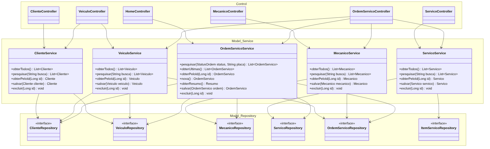

Fonte do diagrama (Mermaid): [docs/diagramas/diagrama-mvc.mmd](docs/diagramas/diagrama-mvc.mmd)

---

## 5. Diagrama MER

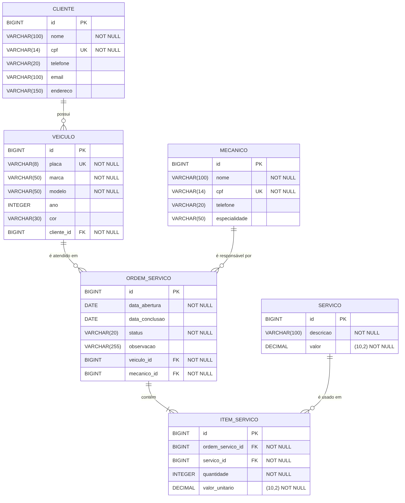

Fonte do diagrama (Mermaid): [docs/diagramas/mer.mmd](docs/diagramas/mer.mmd)

| Tabela | Chave primária | Chaves estrangeiras | Valor único |
|---|---|---|---|
| cliente | id | — | cpf |
| veiculo | id | cliente_id → cliente(id) | placa |
| mecanico | id | — | cpf |
| servico | id | — | — |
| ordem_servico | id | veiculo_id → veiculo(id); mecanico_id → mecanico(id) | — |
| item_servico | id | ordem_servico_id → ordem_servico(id); servico_id → servico(id) | — |

A tabela **item_servico** resolve o relacionamento **N:N** entre `ordem_servico` e `servico`. Ela também guarda a quantidade e o valor do serviço no dia em que a OS foi feita.

As tabelas são criadas pelo Hibernate a partir das entidades. O script equivalente está em [docs/banco.sql](docs/banco.sql) e os dados de exemplo em [src/main/resources/data.sql](src/main/resources/data.sql).

---

## 6. Arquitetura MVC do projeto

```
src/main/java/br/edu/univille/poo/oficina/
├── OficinaApplication.java          → inicia o Spring Boot
├── model/                           → MODEL
│   ├── entity/                      → Cliente, Veiculo, Mecanico, Servico, OrdemServico, ItemServico, StatusOrdem (@Entity)
│   ├── repository/                  → um JpaRepository por entidade (Spring Data JPA)
│   ├── service/                     → ClienteService, VeiculoService, MecanicoService, ServicoService, OrdemServicoService
│   ├── dto/Resumo.java              → totais do painel
│   └── exception/                   → RegraNegocioException
├── control/                         → CONTROL: um @Controller por cadastro + HomeController (painel)
└── util/StringsUtil.java

src/main/resources/
├── templates/                       → VIEW: telas Thymeleaf (HTML)
│   ├── fragments/layout.html        → cabeçalho, menu, mensagens e rodapé
│   ├── home.html                    → painel principal
│   ├── cliente/  veiculo/  mecanico/  servico/  ordem/   → lista.html e form.html
│   └── confirmar-exclusao.html      → tela de exclusão compartilhada
├── static/css/style.css             → VIEW: estilos
├── static/js/ordem-servico.js       → VIEW: adiciona/remove serviços da OS e calcula o total na tela
├── application.properties           → configuração do banco
└── data.sql                         → dados de exemplo
```

### Rotas de cada CRUD (exemplo: clientes)

| Método | URL | Tela / ação |
|---|---|---|
| GET | `/clientes` | Listagem (com pesquisa `?busca=`) |
| GET | `/clientes/novo` | Tela de cadastro |
| GET | `/clientes/{id}/editar` | Tela de edição |
| POST | `/clientes/salvar` | Salva (cadastro ou edição) |
| GET | `/clientes/{id}/excluir` | Tela de confirmação da exclusão |
| POST | `/clientes/{id}/excluir` | Exclui |

As outras rotas seguem o mesmo padrão: `/veiculos`, `/mecanicos`, `/servicos` e `/ordens`.

**Fluxo de uma ação** (exemplo: salvar um cliente):

```
cliente/form.html (botão Salvar cliente)
   → POST /clientes/salvar → ClienteController.salvar(cliente)
      → ClienteService.salvar(cliente)        // valida nome, CPF e duplicidade
         → ClienteRepository.save(cliente)    // Spring Data JPA gera o INSERT/UPDATE
            → banco de dados H2
   ← redirect:/clientes com a mensagem "Cliente salvo com sucesso."
```

---

## 7. Como executar

Requisitos: **Java 17** ou superior. O Maven Wrapper já vem no projeto.

```bash
./mvnw spring-boot:run
```

No Windows: `mvnw.cmd spring-boot:run`

Depois, abra **http://localhost:8080** no navegador.

- O banco H2 é criado em memória a cada execução, já com dados de exemplo.
- Console do banco: **http://localhost:8080/h2-console** (JDBC URL `jdbc:h2:mem:oficina`, usuário `sa`, senha `password`).
- Testes automatizados: `./mvnw test`
