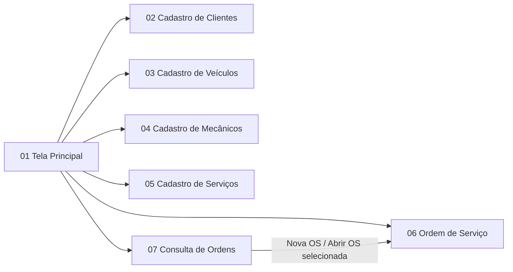
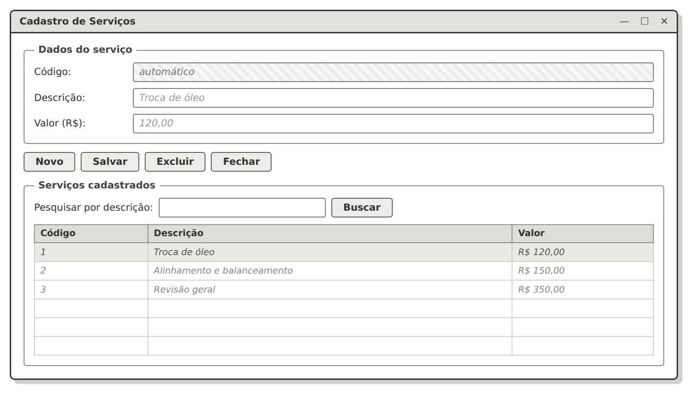
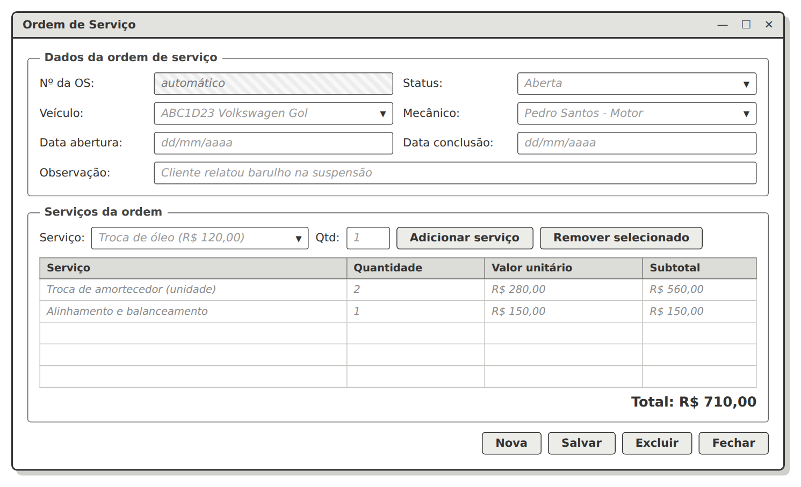
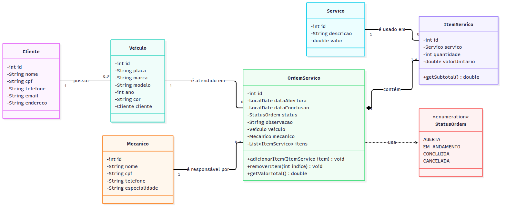

# Sistema de Gestão de Oficina Mecânica

Sistema desktop em **Java Swing**, com banco de dados e padrão **MVC**, desenvolvido para a disciplina de Engenharia de Software.

Este repositório contém a **1ª etapa** do trabalho:

1. [Tema do sistema](#1-tema-do-sistema)
2. [Protótipos de tela](#2-protótipos-de-tela)
3. [Diagrama de classes](#3-diagrama-de-classes)
4. [Diagrama MER](#4-diagrama-mer)

---

## 1. Tema do sistema

O **Sistema de Gestão de Oficina Mecânica** é destinado a oficinas de pequeno porte, que muitas vezes controlam os atendimentos em cadernos ou planilhas.

O sistema permitirá cadastrar:
- os **clientes**;
- os **veículos** desses clientes;
- os **mecânicos** da oficina;
- os **serviços** oferecidos, com seus preços.

Além disso, registrará as **Ordens de Serviço (OS)**. Cada OS indica qual veículo foi atendido, qual mecânico é o responsável, quais serviços foram realizados e o valor total.

### Problemas que o sistema resolve
- Guarda o histórico dos serviços feitos em cada veículo.
- Mostra quem é o dono de cada veículo e como entrar em contato.
- Registra qual mecânico ficou responsável por cada atendimento.
- Calcula automaticamente o valor total da OS.
- Mostra quais ordens estão abertas, em andamento, concluídas ou canceladas.

### Funcionalidades previstas

| # | Funcionalidade | Descrição |
|---|---|---|
| F01 | Manter Clientes | Cadastrar, alterar, excluir e pesquisar clientes |
| F02 | Manter Veículos | Cadastrar, alterar, excluir e pesquisar veículos, vinculando cada um ao seu dono |
| F03 | Manter Mecânicos | Cadastrar, alterar, excluir e pesquisar mecânicos |
| F04 | Manter Serviços | Cadastrar, alterar, excluir e pesquisar serviços e seus preços |
| F05 | Registrar Ordem de Serviço | Abrir uma OS com veículo, mecânico e serviços, com o total calculado |
| F06 | Atualizar Ordem de Serviço | Alterar o status, as datas e os serviços de uma OS |
| F07 | Consultar Ordens | Listar as ordens com filtro por status e por placa |
| F08 | Painel principal | Mostrar os totais de clientes, veículos e ordens por status |

### Requisitos da atividade

| Requisito | Como será atendido |
|---|---|
| Java Swing | Telas com `JFrame`, `JPanel`, `JTable`, `JComboBox` e gerenciadores de layout |
| Integração com banco de dados | Acesso por JDBC |
| 4 ou mais tabelas | 6 tabelas: cliente, veiculo, mecanico, servico, ordem_servico e item_servico |
| Várias telas | 7 telas |
| Padrão MVC | Pacotes `model`, `view` e `controller`, com `dao` para o acesso ao banco |

---

## 2. Protótipos de tela

Os protótipos são wireframes de baixa fidelidade: esboços que mostram como cada tela do sistema será organizada.

**Links para os protótipos:**

| # | Tela | Protótipo |
|---|---|---|
| 01 | Tela Principal | [01-tela-principal.png](01-tela-principal.png) |
| 02 | Cadastro de Clientes | [02-cadastro-clientes.png](02-cadastro-clientes.png) |
| 03 | Cadastro de Veículos | [03-cadastro-veiculos.png](03-cadastro-veiculos.png) |
| 04 | Cadastro de Mecânicos | [04-cadastro-mecanicos.png](04-cadastro-mecanicos.png) |
| 05 | Cadastro de Serviços | [05-cadastro-servicos.png](05-cadastro-servicos.png) |
| 06 | Ordem de Serviço | [06-ordem-de-servico.png](06-ordem-de-servico.png) |
| 07 | Consulta de Ordens de Serviço | [07-consulta-ordens.png](07-consulta-ordens.png) |

### Navegação entre as telas

### 01 — Tela Principal

### 02 — Cadastro de Clientes

### 03 — Cadastro de Veículos

### 04 — Cadastro de Mecânicos

### 05 — Cadastro de Serviços

### 06 — Ordem de Serviço

### 07 — Consulta de Ordens de Serviço

---

## 3. Diagrama de classes

Entidades do sistema: **Cliente, Veiculo, Mecanico, Servico, OrdemServico e ItemServico**, além do enum **StatusOrdem**.

Arquivo: [diagrama-classes.png](diagrama-classes.png)

### Relacionamentos

| Relacionamento | Multiplicidade | Explicação |
|---|---|---|
| Cliente — Veiculo | 1 para 0..* | Um cliente pode ter vários veículos. Cada veículo pertence a um único cliente. |
| Veiculo — OrdemServico | 1 para 0..* | Um veículo pode ter várias ordens ao longo do tempo. Cada ordem é de um único veículo. |
| Mecanico — OrdemServico | 1 para 0..* | Um mecânico pode ser responsável por várias ordens. Cada ordem tem um único mecânico. |
| OrdemServico ◆— ItemServico | 1 para 1..* | **Composição**: os itens fazem parte da ordem e não existem sem ela. Toda ordem tem pelo menos um item. |
| Servico — ItemServico | 1 para 0..* | Um serviço pode aparecer em vários itens. Cada item se refere a um único serviço. |
| OrdemServico ⇢ StatusOrdem | dependência | A ordem usa o enum para indicar sua situação. |

> O cliente não fica ligado diretamente à Ordem de Serviço: ele é obtido pelo veículo (`OS → Veículo → Cliente`). Assim não há risco de a OS apontar para um cliente diferente do dono do veículo.

---

## 4. Diagrama MER

Modelo do banco de dados, criado a partir das entidades do diagrama de classes.

Arquivo: [diagrama-mer.png](diagrama-mer.png)

> No diagrama, `DECIMAL(10-2)` representa `DECIMAL(10,2)`.

### Tabelas e chaves

| Tabela | Chave primária (PK) | Chaves estrangeiras (FK) | Valor único (UK) |
|---|---|---|---|
| cliente | id | — | cpf |
| veiculo | id | cliente_id → cliente(id) | placa |
| mecanico | id | — | cpf |
| servico | id | — | — |
| ordem_servico | id | veiculo_id → veiculo(id); mecanico_id → mecanico(id) | — |
| item_servico | id | ordem_servico_id → ordem_servico(id); servico_id → servico(id) | — |

### Cardinalidades

| Relacionamento | Cardinalidade | Leitura |
|---|---|---|
| CLIENTE — VEICULO | 1 : N | Um cliente possui vários veículos. Um veículo pertence a um cliente. |
| VEICULO — ORDEM_SERVICO | 1 : N | Um veículo recebe várias ordens. Uma ordem é de um veículo. |
| MECANICO — ORDEM_SERVICO | 1 : N | Um mecânico executa várias ordens. Uma ordem tem um mecânico. |
| ORDEM_SERVICO — ITEM_SERVICO | 1 : N | Uma ordem contém um ou mais itens. Um item pertence a uma ordem. |
| SERVICO — ITEM_SERVICO | 1 : N | Um serviço aparece em vários itens. Um item referencia um serviço. |

A tabela **ITEM_SERVICO** resolve o relacionamento **N:N** entre ORDEM_SERVICO e SERVICO. Ela também guarda a quantidade e o valor do serviço no dia em que a OS foi feita.
